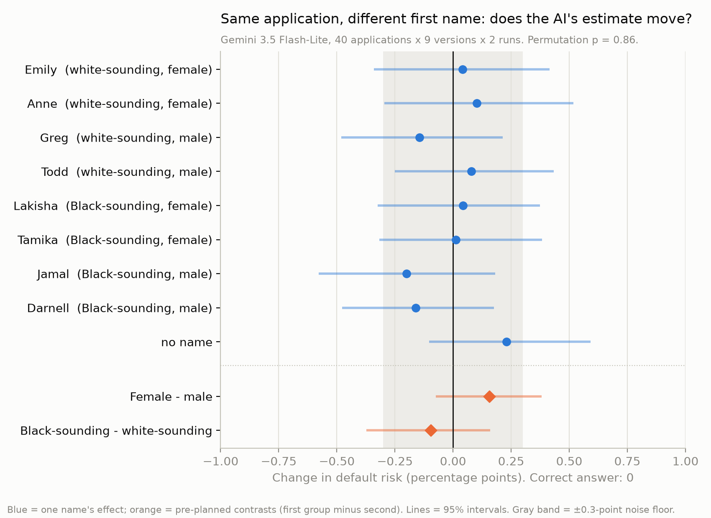
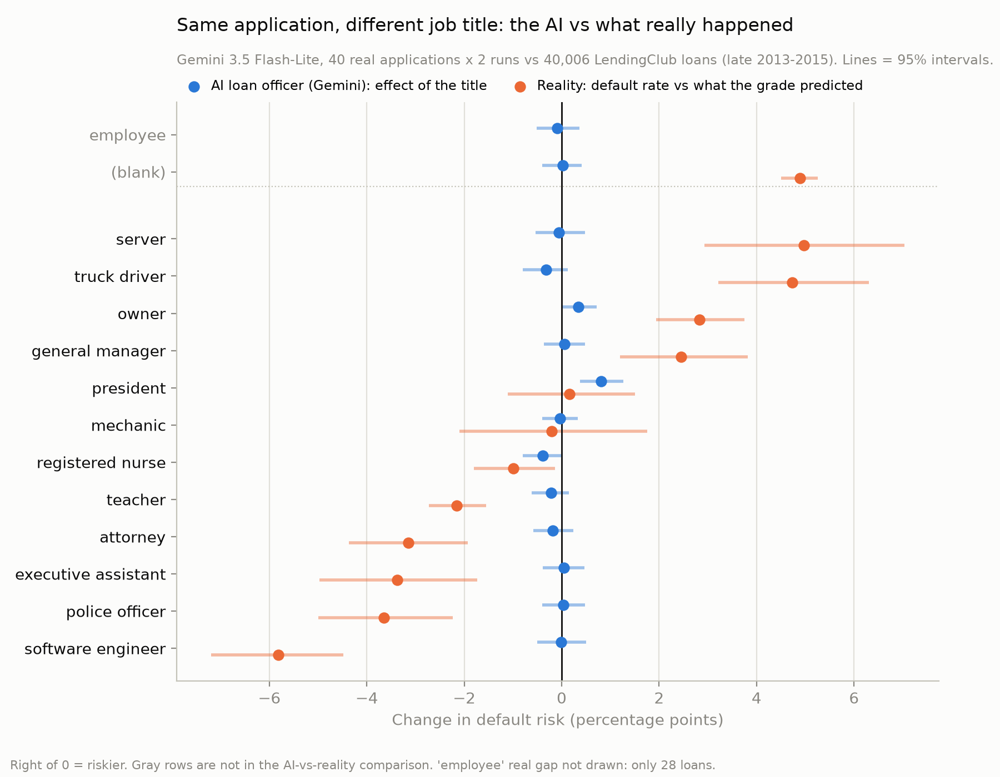
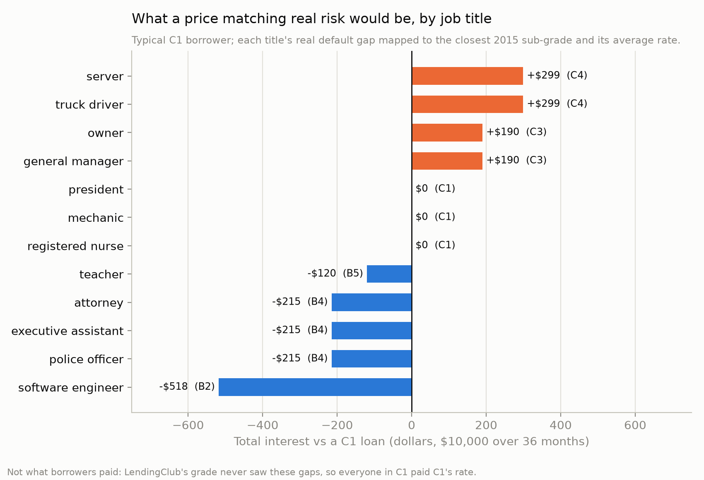
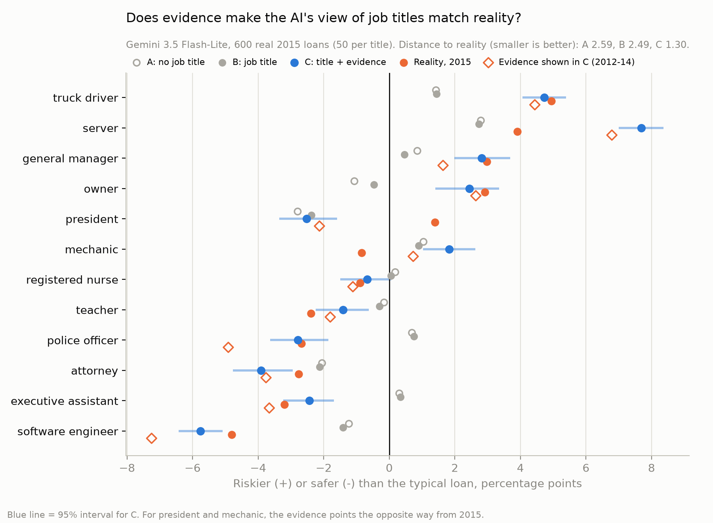

# LoanLens: check your loan, and the AI judging it

LoanLens checks whether a personal-loan rate matches a borrower's real risk, and audits whether an AI loan officer judges borrowers fairly. Using 618,584 real LendingClub loans and three pre-registered experiments with Gemini, we found that the AI ignores applicants' names, as the law requires, but also ignores job titles that really do predict repayment. Given evidence about job titles, it moves toward reality, but it ends up exactly as accurate as the evidence it is given.

## Four findings

### 1. The AI ignores names, as the law requires

The test used 40 real applications in 9 versions each, identical except for the first name, with 2 runs. The names were 8 from Bertrand & Mullainathan (2004), plus a no-name version. The correct answer, under the Equal Credit Opportunity Act, is zero.

- **Female minus male names:** +0.16 points (95% interval −0.07 to +0.38).
- **Black-sounding minus white-sounding names:** −0.10 points (−0.37 to +0.16).
- **Do names matter at all?** Permutation test p = 0.86.



### 2. It ignores job titles, which really predict repayment

- **The real gaps are large.** Within the same LendingClub grade, borrowers with different job titles really defaulted between **5.8 points less** (software engineer) and **5.0 points more** (server) than their grade predicted. This comes from the 40,006 loans that carry one of the 12 tested titles.
- **Gemini barely reacts.** On identical applications, changing only the job title moved its estimate by between −0.39 and +0.81 points. The slope against reality is +0.01, and the permutation test gives p = 0.067.
- **The gap is worth real money.** Priced to match real risk, a typical C1 borrower would pay from **\$518 less** (software engineer) to **\$299 more** (server) in total interest on a \$10,000, 36-month loan. That is a spread of about **\$800**.





### 3. Evidence moves it toward reality

The test used 600 real 2015 loans, 50 per title. We added a table of each title's real gap, computed only from loans issued before 2015.

- **Closer to reality:** the distance between the AI's job pattern and 2015 reality fell from **2.49 to 1.30** points (difference −1.19, interval −1.57 to −0.74).
- **About the right size:** the slope rose from +0.21 to +1.06.
- **Showing the job title alone did nothing:** distance change −0.10 (−0.25 to +0.08).



### 4. It ends up exactly as accurate as the evidence it is given, and reliability labels didn't help

- **No better than the table:** the evidence table on its own sits 1.27 points from reality, about the same as the AI with the table (1.30). This comparison is exploratory, not pre-registered.
- **It followed wrong evidence:** for president, the pre-2015 evidence pointed the opposite way from 2015, and the AI followed it.
- **Reliability labels changed nothing detectable:** adding 95% intervals, stability flags and an instruction to discount uncertain evidence gave a distance of 1.26 (difference from plain evidence −0.04, interval −0.22 to +0.12).

## Beats simple rules

| Comparison (2015 loans the model never saw) | AUC |
| --- | --- |
| **Our model vs FICO score alone** | **0.669** vs 0.602 |
| **LendingClub grade + our model vs grade alone** | **0.693** vs 0.679 (difference +0.015, interval +0.013 to +0.016) |

**"Is my rate fair?" holds up on real loans.** When our model places a 2015 borrower in a better or worse sub-grade than LendingClub did, their real default rate moves the same way:

| Model's placement vs real sub-grade | Loans | Actual default | Real grade predicted | Difference (points) |
| --- | --- | --- | --- | --- |
| 5+ grades better | 45,723 | 18.8% | 23.4% | −4.5 |
| 3–4 better | 33,291 | 14.8% | 17.2% | −2.4 |
| 1–2 better | 46,793 | 13.0% | 14.1% | −1.2 |
| same sub-grade | 29,413 | 11.2% | 11.5% | −0.3 |
| 1–2 worse | 46,808 | 13.5% | 12.3% | +1.3 |
| 3–4 worse | 34,754 | 14.6% | 12.2% | +2.4 |
| 5+ grades worse | 46,244 | 16.9% | 12.5% | +4.5 |

For comparison, Gemini on 500 random 2015 loans scored an AUC of 0.625, against 0.579 for FICO alone and 0.657 for the grade on the same loans. It is not detectably different from either.

## What LoanLens does

LoanLens is a small web app with four tabs:

1. **Is my rate fair?** Enter the loan, the interest rate you were offered, and your details. LoanLens shows our model's risk, the sub-grade that risk deserves, and the fair rate (LendingClub's 2015 average for that sub-grade). It also shows how much more or less total interest you'd pay than with your offer. For the 12 tested jobs, you can choose to adjust for job-related risk our model misses.
2. **Will an AI judge me fairly?** For each job: how borrowers really repaid, against how much Gemini's estimate moved, and what evidence changes. It also includes the name test.
3. **What would get me a better rate?** It tries simple changes, such as borrowing less, paying down credit cards or lowering debt-to-income, and reports the smallest one that moves you up a sub-grade.
4. **For lenders: audit report.** The report card for every loan officer tested, plus the money charts.

**To run it**, in PowerShell from the project folder. It uses only files already in `models/` and `outputs/`, so the LendingClub data isn't needed:

```powershell
py -3.12 -m venv .venv
.venv\Scripts\Activate.ps1
pip install -r requirements.txt
python app.py
```

Then open http://127.0.0.1:7860. To rerun the notebooks you also need the Kaggle data; see `SETUP.md`.

## Notebooks

| Notebook | What it does |
| --- | --- |
| `01_data.ipynb` | Loads LendingClub and keeps 618,584 finished 36-month loans issued 2007–2015 |
| `02_model_vs_grade.ipynb` | Trains a default model on 2007–2014, tests it on 2015 against LendingClub's grade, and checks for hindsight |
| `03_job_titles_reality.ipynb` | Each job title's real default gap compared with its grade, and the employer-name data finding |
| `04_ai_loan_officer.ipynb` | Gemini scores 40 applications × 14 job titles, plus the repeat run, the persona prompt and the competence check |
| `05_ai_vs_reality.ipynb` | The AI's job-title effects against reality, robustness checks and deviations from the plan |
| `06_report_card_and_money.ipynb` | The money translation, FICO baseline, rate-fairness validation and report card |
| `07_name_test.ipynb` | The name test: 40 applications × 9 name conditions |
| `08_evidence_fix.ipynb` | Can evidence cure the blindness? Conditions A–D on 600 real loans |

## Pre-registration

Each experiment's question, design, analysis and rules were written down and committed **before** its first AI request:

- `PREREGISTRATION.md`, the job-title test (committed 12:27; first request 12:42, local time).
- `PREREGISTRATION_NAMES.md`, the name test (15:10; first request 15:12).
- `PREREGISTRATION_FIX.md`, the evidence fix (21:23; first request 21:25). Its condition D addendum was committed at 22:00, with the first D request at 22:02.

Clarification notes added later are dated and appended; the original text is unchanged.

## Limitations

- **Job titles only exist from late 2013.** Before then, LendingClub's job field held employer names. So the job-title results rest on the 40,006 loans issued late 2013–2015 that carry one of the 12 titles.
- **Approved US borrowers only.** These are LendingClub loans, 36-month terms, issued 2007–2015, priced at 2015 rates. People who were turned down aren't in the data.
- **One AI model family.** All results are for `gemini-3.5-flash-lite`. A second model (Gemma 4 31B, then Gemini 3.8 Flash) was attempted and blocked by server errors (500/503/504), so the result is tested on one model family only.
- **The hindsight check.** The main model trained on 2007–2014 loans, some of which hadn't finished by early 2015. Trained only on 2007–2011 loans, all finished in time, its 2015 AUC is 0.631 instead of 0.669, still above FICO alone (0.602).
- **Deviations from the pre-registration** are listed in notebook 05:
  - all 12 titles were used instead of only the sign-stable 10 (the result is the same);
  - the third prompt wording and the split-half check were not run;
  - bad replies were retried once instead of three times (none were needed).
  - Condition D was designed after seeing conditions A–C.
- **Job titles can stand in for sex.** An AI that prices on job titles, as with evidence it does (a \$708 spread between titles), trades fairness risk for accuracy. This data has no sex field to measure that directly.

## AI tools used

- **Claude** (Opus 5.5 and Fable 5.2, through Claude Code and the Claude app) for code and review. 
*No AI tools were used for idea, plan, or method generation.*
- **The Gemini API** is the system under test.

## Sources

- **Data:** LendingClub accepted loans 2007–2018Q4 (Kaggle, uploaded by wordsforthewise), file `accepted_2007_to_2018Q4.csv`.
- **Names study:** Bertrand, M. and Mullainathan, S. (2004). "Are Emily and Greg More Employable Than Lakisha and Jamal? A Field Experiment on Labor Market Discrimination." *American Economic Review* 94(4), 991–1013.
- **Models:**
  - tested: `gemini-3.5-flash-lite`;
  - attempted: `gemma-4-31b-it`;
  - assistance: `claude-opus-5-5` and `claude-fable-5-2`.
- **Libraries:** pandas 3.1.1, numpy 2.5.4, scikit-learn 1.9.1, scipy 1.18.1, matplotlib 3.11.2, pyarrow 26.0.1, joblib 1.6.0, Gradio 6.32.0, google-genai 3.3.0, python-dotenv 1.2.4, httpx 0.28.1, httpx2 2.16.0.

This project is a prototype and is not financial advice.
